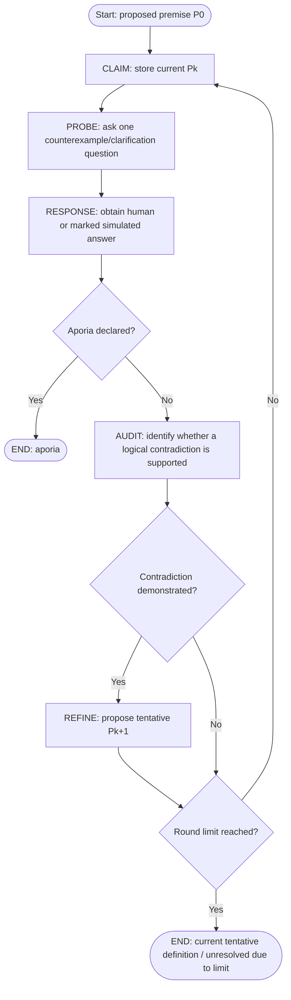

# 02 — Socratic Protocol Map

## State machine



## State transitions and criteria

1. **CLAIM:** Receive premise P0 or updated tentative definition Pk.
2. **PROBE:** Generate one question directed at a boundary case, definition, or assumption.
3. **RESPONSE:** Obtain an answer from the real user, pre-supplied test data, or an **explicitly labelled** model-simulated respondent.
4. **AUDIT:** Compare the response against Pk. Do not label mere disagreement a contradiction. Explain any claimed inconsistency.
5. **REFINE:** If contradiction is established, propose Pk+1 *tentatively*. Genuine co-authorship requires respondent confirmation; the script's automatic mode is a demonstration only.
6. **TERMINATE:** End when aporia is acknowledged or the finite loop ends. Hitting a maximum round count is not proof of philosophical resolution.

## Pseudocode

```text
P := initial_claim
history := []
for k in 0 ... maximum_rounds - 1:
    question := LLM.ask_socratic_question(P, history)
    answer := respondent(question)
    if answer == explicit_aporia:
        return APORIA, history
    verdict := LLM.audit_claim_answer(P, question, answer)
    history.append(question, answer, verdict)
    if verdict == demonstrable_contradiction:
        P := LLM.propose_tentative_refinement(P, answer, verdict)
    else:
        keep P; ask another question on next pass
return ROUND_LIMIT, P, history
```

## Example dry-run of logic (illustrative, not actual API execution)

- P0: "An AI agent is benevolent if it obeys human commands."
- Probe: "Would obeying a command to harm an innocent person still be benevolent?"
- Response: "No; such a command should be refused."
- Audit: This conflicts with the unrestricted **if obedience, then benevolence** interpretation when such a command is obeyed.
- Suggested P1: "Benevolence requires following legitimate human requests while refusing requests that foreseeably harm others."
- Continue: Ask what counts as legitimate and how foreseeable harm is assessed.

**Limitations:** A language model's contradiction judgment is fallible; to validate it rigorously, inspect the explicit premise, counterexample, and reasoning. The code labels refinements as tentative.
